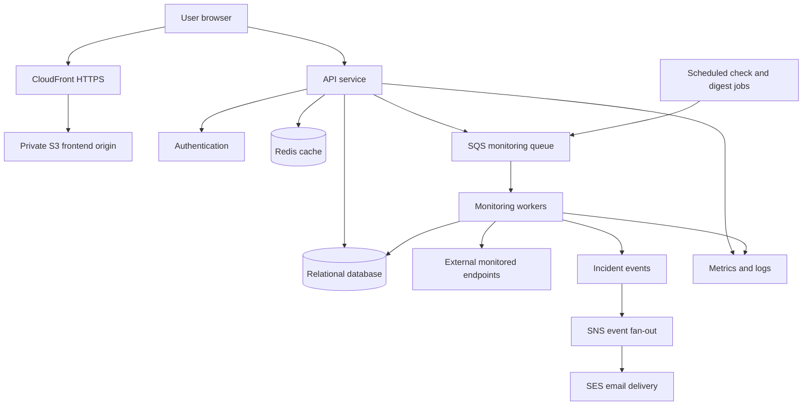

# UptimePulse Architecture Overview

## 1. Goals

UptimePulse provides user authentication, endpoint monitoring, public status pages, incident history, and email digests. The architecture must be secure, reproducible, observable, and economical for a small pilot.

## 2. Delivery strategy

The client approved **local Kubernetes first, AWS pilot later**.

1. Build and test application components locally.
2. Containerize services and validate them with Docker.
3. Deploy to kind using Helm.
4. Reconcile deployments with Argo CD.
5. Validate autoscaling and policy controls locally where supported.
6. Integrate AWS services incrementally.
7. Provision EKS and production AWS dependencies only after cost and readiness review.

Local validation is not a substitute for AWS integration tests. In particular, Karpenter's EC2 provisioning, IRSA/EKS Pod Identity, AWS Load Balancer Controller, ACM/CloudFront behavior, and managed AWS service permissions require an AWS test environment.

## 3. Logical request and event flow

The diagram is a target logical design, not a claim that these resources have been deployed. Exact event routing and whether SNS is needed between incident detection and email delivery will be confirmed during application design.

## 4. Target AWS service mapping

| Capability | Target service |
|---|---|
| Static frontend | Private S3 + CloudFront Origin Access Control |
| TLS | ACM certificate in the region required by CloudFront |
| Container registry | ECR |
| Kubernetes | EKS |
| Relational persistence | RDS PostgreSQL initially, subject to application compatibility |
| Cache | ElastiCache Redis |
| Work queue | SQS with dead-letter queue |
| Event fan-out | SNS where multiple subscribers are needed |
| Email | SES |
| Secrets | Secrets Manager + External Secrets Operator |
| Metrics/logs | Prometheus, Grafana, Loki, CloudWatch |
| Identity federation | GitHub Actions OIDC; EKS workload identity via IRSA or EKS Pod Identity |

## 5. Environment model

| Environment | Purpose | Lifecycle |
|---|---|---|
| Local | Main development and fast feedback | Persistent on developer workstation |
| AWS dev/integration | Validate AWS-specific integrations | Short-lived; provision only when needed |
| AWS pilot | Controlled real-user service | Explicitly approved and cost-monitored |

Do not create always-on duplicate clusters for every environment. Use separate state keys, configuration, IAM roles, and resource tags.

## 6. Ownership boundaries

- Terraform: VPC, IAM, ECR, EKS, data services, messaging, supporting AWS infrastructure, and Terraform backend bootstrap.
- CloudFormation: frontend S3/CloudFront hosting stack only.
- Ansible: standalone Linux host baseline only when unmanaged EC2 hosts are actually required.
- GitHub Actions: test, build, scan, publish, and propose GitOps image updates.
- Argo CD: reconcile Kubernetes desired state from Git.
- Helm: package Kubernetes workloads and platform configuration.

Never manage the same AWS resource from both Terraform and CloudFormation.

## 7. Key design constraints

- Private database and cache subnets; no public database endpoints.
- No inbound SSH from the public internet by default; prefer Systems Manager Session Manager.
- No secrets in Git, images, Terraform outputs, or CI logs.
- Queue consumers must be idempotent and tolerate at-least-once delivery.
- Monitoring workers need timeouts, bounded retries, and a DLQ.
- Endpoint checks must defend against SSRF: restrict schemes, block loopback/private/link-local and cloud metadata destinations, validate DNS resolutions, and re-check redirects.
- Apply per-user monitor quotas, request rate limits, and bounded check frequency.
- Set explicit resource requests/limits and autoscaling maximums.
- Use health/readiness probes and graceful shutdown for workers.

## 8. Open decisions

1. Final API/frontend framework and authentication model.
2. Database engine based on application compatibility and current regional pricing.
3. Monitoring interval, timeout, retry, and retention policies.
4. Pilot availability objective and acceptable recovery point/time.
5. Email sender domain and SES production-access readiness.
6. Whether SNS is required in the initial notification path or SQS + SES is sufficient.
7. AWS region confirmation after checking service availability, latency, and pricing.
